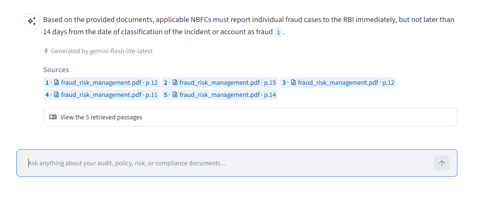
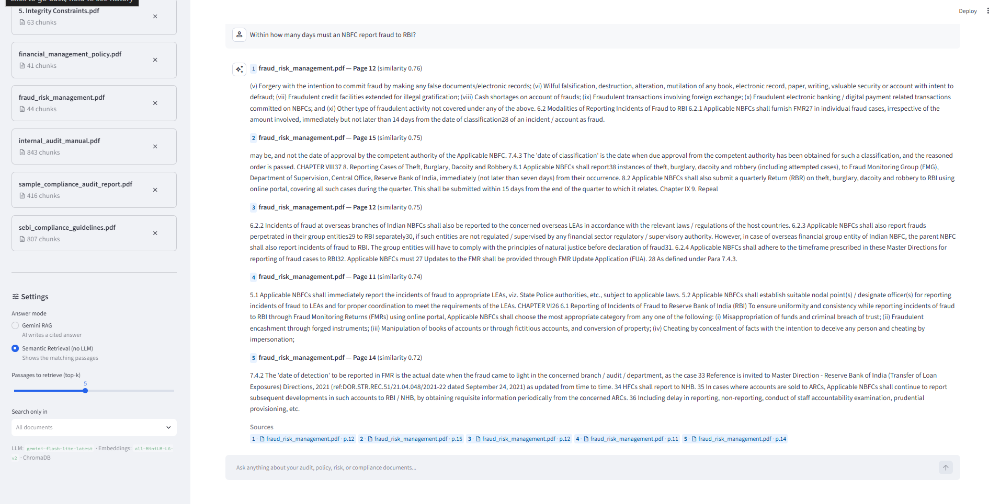
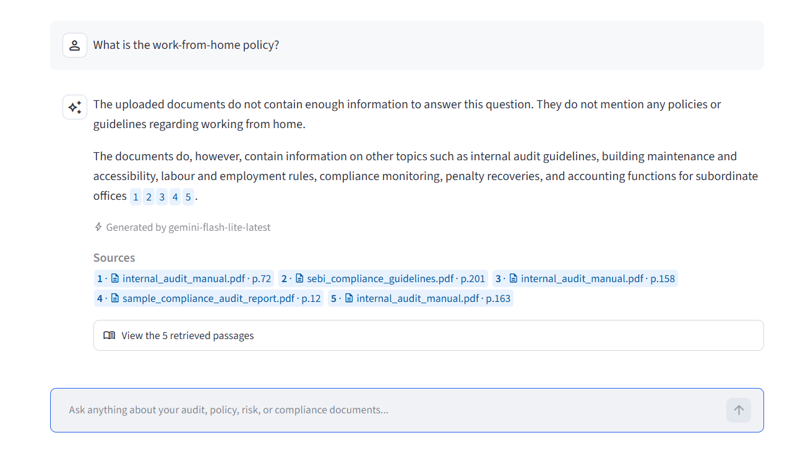

# Audit & Policy Document Intelligence System (APDIS)

Ask questions in plain English about audit reports, financial policies, risk-management guidelines and compliance documents — and get answers grounded in those PDFs, with the **document name and page number** for every source.

APDIS is a Retrieval-Augmented Generation (RAG) application built from scratch in modular Python (no LangChain/LlamaIndex), so every step of the pipeline is visible and testable.

**Stack:** Python 3.12 · PyMuPDF · Sentence Transformers (`all-MiniLM-L6-v2`) · ChromaDB · Google Gemini (`google-genai` SDK) · Streamlit · pytest



---

## Results

Tested on 5 real public documents — RBI Master Directions on Fraud Risk Management in NBFCs, SEBI LODR Master Circular, CAG Compliance Audit Report, DoT Internal Audit Manual and World Bank Financial Management slides — **778 pages, 2,151 chunks**, using a 30-question evaluation set (28 answerable with verified pages + 2 unanswerable).

| Metric | Score |
|---|---|
| Retrieval Hit@1 | 68% |
| Retrieval Hit@5 | **93%** |
| Retrieval MRR | 0.774 |
| Answers citing their sources | **28 / 28** |
| Correct abstentions on unanswerable questions | **2 / 2** |

Hit@5 matters most: the top 5 chunks are what Gemini reads, so in 26 of 28 questions the correct page reached the model.

### Gemini RAG — answer with page citations


### Semantic retrieval only (no LLM)


### Declining a question the documents can't answer


---

## How it works

```
INGESTION                                   QUESTION ANSWERING
PDF ──► extract text per page (PyMuPDF)     question ──► embed (MiniLM)
    ──► clean (headers/footers, hyphens)              ──► cosine search in ChromaDB
    ──► chunk (~1,000 chars, 200 overlap,             ──► top-k chunks + source/page
        never crossing a page)                        ──► Mode 1: show passages (no LLM)
    ──► embed (384-dim, normalised)                   ──► Mode 2: Gemini answers from
    ──► store in ChromaDB + {source, page}                    passages only, cites [n]
```

Two answer modes let you compare **semantic retrieval alone** against **retrieval + Gemini**, which shows exactly what the LLM adds.

## Quick start (Windows)

1. Clone or extract this folder, e.g. to `C:\AI\Projects\06_Generative_AI\Audit-Policy-Document-Intelligence`
2. Put PDFs in `data\raw\documents\` (see that folder's README for the documents used above). If the folder is empty, setup creates three synthetic sample policies instead.
3. Double-click **`setup.bat`** — creates `.venv`, installs libraries, creates `.env` and builds the vector database.
4. Open **`.env`** and set `GEMINI_API_KEY=` to your key (free at https://aistudio.google.com/apikey).
5. Double-click **`run_app.bat`** — the app opens at http://localhost:8501.

Manual equivalent (PowerShell, from the project folder):

```powershell
py -3.12 -m venv .venv
.\.venv\Scripts\Activate.ps1
pip install -r requirements.txt
copy .env.example .env          # then paste your key into .env
python scripts\ingest.py
streamlit run app.py
```

## Useful commands

| Command | What it does |
|---|---|
| `python scripts/list_models.py` | Lists Gemini models your key can use and makes a test call |
| `python scripts/ingest.py [--reset]` | Ingests every PDF in `data/raw/documents/` |
| `python scripts/ask.py "question"` | Ask from the terminal (`--mode retrieval` for no-LLM mode) |
| `python scripts/evaluate.py --questions evaluation/test_questions_real.json [--rag]` | Retrieval Hit@k / MRR; with `--rag` also answer quality and hallucination checks |
| `python scripts/make_sample_docs.py` | Creates three synthetic sample PDFs for a quick demo |
| `pytest` | Runs the unit tests (29) |

## Gemini model choice

Configured model: **`gemini-flash-lite-latest`** (set in `.env`), with fallbacks `gemini-flash-latest` and `gemini-2.5-flash-lite`. In benchmarks (`scripts/benchmark.py`) Lite answered in ~3 s with the same 87% key-fact recall as the larger Flash model.

Speed: answers are **streamed** into the app, so text appears as soon as Gemini starts writing, and the model's hidden "thinking" step is turned down (`GEMINI_THINKING=low` in `.env`; `off` is fastest, `default` lets the model decide), since answering from five short passages doesn't need long reasoning. Retrieval itself takes about 0.1 s.

The client handles the free tier's limits automatically:
- **Rate limit (HTTP 429):** switches to the next model immediately and puts the limited model on a 60-second cooldown, so later questions don't wait on it.
- **Model not available for the key:** skipped for the rest of the session.
- **Server error:** one quick retry, then the next model; requests time out after 60 seconds.
- The model that produced each answer is shown under it in the app.

Free-tier notes: limits are per Google Cloud project (check yours at https://aistudio.google.com/rate-limit), and Google may use free-tier prompts to improve its products — don't upload confidential documents while on the free tier. Semantic Retrieval mode needs no API calls at all.

## Project structure

```
Audit-Policy-Document-Intelligence/
├── app.py                         Streamlit UI
├── src/
│   ├── document_processing/       pdf_loader.py · text_cleaner.py · text_chunker.py
│   ├── embeddings/                embedding_model.py
│   ├── vector_store/              chroma_db.py
│   ├── retrieval/                 retriever.py
│   ├── llm/                       gemini.py · prompts.py
│   ├── chatbot/                   assistant.py   (ties everything together)
│   └── utils/                     config.py      (all settings, reads .env)
├── scripts/                       ingest · ask · evaluate · list_models · make_sample_docs
├── tests/                         pytest suite
├── evaluation/                    test_questions_real.json (30 Qs) · test_questions.json (24 Qs) → results.csv
├── data/raw/documents/            your PDFs (never modified)
├── data/processed/                extracted text + chunks as JSON (for inspection)
├── data/vectorstore/chroma_db/    persistent ChromaDB
├── docs/                          overview · architecture · methodology · images/
└── notebooks/exploration.ipynb    step-by-step walkthrough of the pipeline
```

## Design decisions

- **Chunk size ~1,000 characters, not 800 tokens.** `all-MiniLM-L6-v2` reads at most 256 word-pieces; longer chunks are silently truncated before embedding, so the end of an 800-token chunk would be invisible to search. ~1,000 characters ≈ 200–250 tokens fits fully.
- **Chunks never cross page boundaries**, so every citation points to one exact page.
- **Stable chunk IDs** (file hash + page + index): re-ingesting a file replaces it instead of duplicating it.
- **Repeated headers/footers are removed** (lines appearing on ≥50% of pages), so they don't pollute every chunk.
- **Grounding prompt**: Gemini must answer only from numbered excerpts, cite them as `[n]`, and say clearly when the documents don't contain the answer.
- **Retrieval mode needs no API key**, so the app is usable and demonstrable even offline or when the Gemini quota is used up.
- **Model output is rendered as plain Markdown**, not HTML, so text inside a PDF cannot inject HTML into the page.

## Evaluation

Two question sets, each with the expected file and the page(s) where the answer is found, plus unanswerable questions for hallucination checks:

- `evaluation/test_questions_real.json` — 30 questions on the five real documents. Every expected answer was checked against the page text.
- `evaluation/test_questions.json` — 24 questions on the synthetic sample documents (`scripts/make_sample_docs.py`)

Page numbers are **PDF page positions** (what a PDF viewer jumps to), which can differ from the numbers printed on the page in reports with roman-numbered front matter.

`scripts/evaluate.py` reports:

- **Retrieval:** Hit@1, Hit@k, MRR
- **Gemini RAG (`--rag`):** keyword recall of key facts, share of answers with citations, correct abstentions on unanswerable questions

Per-question results are written to `evaluation/results.csv`. Add questions for your own documents in the same format.

## Limitations / next steps

- **Retrieval misses on general wording:** a question like "Which NBFCs do the directions apply to?" matches applicability text in several documents; a cross-encoder re-ranker or hybrid BM25 + vector search would lift Hit@1.
- **Slide-style PDFs:** tables and multi-column slides (e.g. the World Bank deck) extract as jumbled text, which weakens their embeddings.
- **Scanned PDFs** need OCR (detected and flagged, not yet processed) — add `pytesseract` or PyMuPDF OCR.
- **Single shared knowledge base:** all uploads go into one collection; a public deployment would need per-user workspaces, upload limits and rate limiting.
- Further upgrades: conversation memory for follow-up questions, a larger multilingual embedding model.
